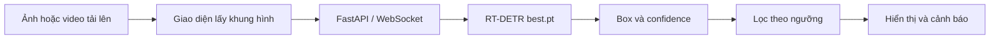
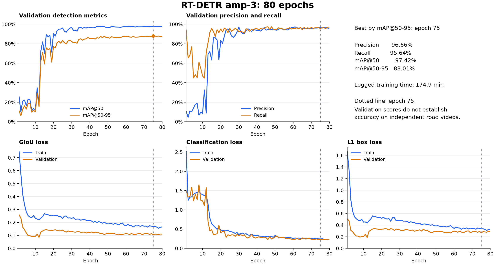

# RTDETR-FloodDetection

Ứng dụng nhận diện **dấu hiệu ngập lụt trên đường phố đô thị** bằng RT-DETR, Ultralytics và PyTorch. Backend FastAPI xử lý ảnh/video và trả tọa độ vùng nghi ngập cùng độ tin cậy để giao diện vẽ bounding box.

Mô hình có một lớp: **`0 = flood`**. Kết quả thể hiện dấu hiệu ngập, không xác định độ sâu nước hay mức độ nguy hiểm.

## Chức năng hiện tại

- Tải ảnh JPG, PNG hoặc WebP để phân tích.
- Tải video MP4, WebM hoặc OGG; hỗ trợ phát, tạm dừng, tua, tốc độ và lặp.
- Chạy trực tiếp checkpoint `best.pt`; tự chọn GPU CUDA khi PyTorch nhận GPU, nếu không sẽ dùng CPU.
- Hiển thị box và nhãn khi confidence đạt ngưỡng người dùng chọn.
- Dự đoán dưới ngưỡng không vẽ box; điểm cao nhất vẫn hiển thị trong bảng chỉ số.
- Hiển thị FPS xử lý, độ trễ, số vùng phát hiện, lưu snapshot và xuất nhật ký CSV.
- Giao diện phục vụ trực tiếp từ FastAPI, không cần chạy frontend bằng npm.



## Cài đặt

### 1. Clone repository và tạo môi trường

Dùng Python 3.11 trở lên. Môi trường phát triển hiện tại dùng Python 3.13.

Cài Git và [Git LFS](https://git-lfs.com/) để tải checkpoint đi kèm repository.

```powershell
git lfs install
git clone https://github.com/trinhvanhao112233-commits/RTDETR-FloodDetection.git
cd RTDETR-FloodDetection
python -m venv .venv
.\.venv\Scripts\python.exe -m pip install --upgrade pip
```

Nếu dùng GPU NVIDIA, cài bản PyTorch/CUDA phù hợp theo [hướng dẫn PyTorch](https://pytorch.org/get-started/locally/) vào môi trường `.venv`, sau đó cài các thư viện của server:

```powershell
.\.venv\Scripts\python.exe -m pip install -r .\flood_detector_server\requirements.txt
```

Kiểm tra PyTorch đã nhận GPU:

```powershell
.\.venv\Scripts\python.exe -c "import torch; print('CUDA:', torch.cuda.is_available()); print(torch.cuda.get_device_name(0) if torch.cuda.is_available() else 'CPU')"
```

### 2. Chuẩn bị checkpoint

Đặt mô hình RT-DETR đã huấn luyện tại:

```text
flood_detector_server/best.pt
```

Repository kèm [checkpoint best.pt của lượt amp-3](flood_detector_server/best.pt), được lưu bằng Git LFS, dung lượng khoảng 66,2 MB. Checkpoint có một lớp `flood`, ID `0`, với các chỉ số validation trình bày bên dưới.

Nếu clone chưa tải được trọng số thực, chạy từ thư mục repository:

```powershell
git lfs pull
```

SHA256 của checkpoint đi kèm:

```text
f0cb1cdd1d8a03b5c22d6419ecd436b5e25678a9cb9096b770d1572c2cb75f0f
```

Bạn cũng có thể thay bằng mô hình RT-DETR đã huấn luyện riêng, có đúng một lớp `flood` hoặc `Flood`, ID `0`. Dataset và môi trường ảo được lưu riêng.

### 3. Chạy ứng dụng

Chạy từ thư mục gốc repository:

```powershell
.\.venv\Scripts\python.exe .\flood_detector_server\main.py
```

Mở **http://localhost:8000/**. Chọn **Tệp Video** hoặc **Ảnh Đơn** để phân tích. Giữ terminal mở; nhấn `Ctrl + C` để dừng.

Để chạy bằng cổng khác:

```powershell
.\.venv\Scripts\python.exe -m uvicorn main:app --app-dir flood_detector_server --host 127.0.0.1 --port 8001
```

Khi đó mở **http://127.0.0.1:8001/**. Sau khi cập nhật giao diện, nhấn `Ctrl + F5` để tải lại JavaScript.

## Chọn thiết bị và checkpoint

Thiết lập biến môi trường trong PowerShell trước khi chạy server:

```powershell
$env:MODEL_PATH = 'D:\models\best.pt'
$env:MODEL_DEVICE = 'cuda:0'
.\.venv\Scripts\python.exe .\flood_detector_server\main.py
```

- `MODEL_PATH`: đường dẫn checkpoint `.pt`; mặc định là `flood_detector_server/best.pt`.
- `MODEL_DEVICE`: mặc định `auto`; nhận `cpu` hoặc `cuda:0`.
- Khởi động lại server sau khi thay checkpoint.

Mở `/health` để xác nhận `model_loaded`, `device`, `gpu_name` và `model_path`. Có GPU trong máy chưa bảo đảm PyTorch đã nhận CUDA.

## Ngưỡng tin cậy và FPS

Ngưỡng mặc định là **45%**. Tăng ngưỡng có thể giảm báo nhầm nhưng cũng tăng bỏ sót. Confidence là điểm của từng dự đoán, không phải độ chính xác của cả mô hình.

Ví dụ, khi ngưỡng là 85%, dự đoán 90% được vẽ box và có thể kích hoạt cảnh báo; dự đoán 70% chỉ còn điểm trong bảng chỉ số.

FPS Limit là số khung hình tối đa giao diện gửi trong một giây. Code đợi kết quả khung trước rồi mới gửi tiếp, nên FPS phân tích thực tế còn phụ thuộc thiết bị, độ trễ và nguồn video. FPS xử lý AI khác FPS gốc của video.

## Huấn luyện trên Kaggle

Xem [hướng dẫn huấn luyện](flood_training/README.md).

| Notebook | Mục đích |
| --- | --- |
| [train_kaggle.ipynb](flood_training/train_kaggle.ipynb) | Huấn luyện một lớp flood từ pretrained RT-DETR-L |
| [finetune_kaggle.ipynb](flood_training/finetune_kaggle.ipynb) | Học thêm dữ liệu từ checkpoint cũ, kiểm tra và gộp dữ liệu trước khi train |

Bật GPU và Internet trên Kaggle, thêm dữ liệu vào Input và điền đúng đường dẫn. Với fine-tune, dùng đúng checkpoint ban đầu và kiểm tra SHA256 trong notebook. Giữ train/validation/test tách biệt theo nguồn hoặc video, tránh các khung hình gần nhau xuất hiện ở nhiều tập.

Ảnh ngập cần bounding box hoặc polygon YOLO. Ảnh không ngập có file nhãn rỗng; nên bao gồm đường khô, đường ướt và vũng nước để kiểm tra báo nhầm.

## Kết quả validation tham khảo

Lượt `rtdetr_flood_only_amp-3` chạy 80 epoch. Epoch tốt nhất theo mAP@50–95 trong CSV là **75**:

| Precision | Recall | mAP@50 | mAP@50–95 |
| ---: | ---: | ---: | ---: |
| 96,66% | 95,64% | 97,42% | 88,01% |

Nguồn: [lịch sử 80 epoch](docs/metrics/amp3_results.csv). Đây là kết quả trên validation của lượt train, chưa chứng minh độ chính xác trên video đường phố độc lập và không dùng để so sánh công bằng với lượt train có validation khác.



## API

| Endpoint | Chức năng |
| --- | --- |
| `GET /` | Giao diện web |
| `GET /health` | Trạng thái mô hình và thiết bị |
| `POST /api/detect` | Phân tích ảnh, multipart field `file` hoặc raw body |
| `WS /ws/flood-detection` | Nhận khung hình JPEG và trả kết quả |
| `WS /ws/youtube-detection` | API đọc luồng YouTube; không có tab YouTube trên giao diện hiện tại |

Endpoint YouTube bổ sung cần Internet và Node.js; việc đọc nguồn công khai còn phụ thuộc khả năng truy cập video. Luồng này không lưu toàn bộ video xuống máy.

Ví dụ gọi API ảnh bằng PowerShell:

```powershell
curl.exe -X POST http://localhost:8000/api/detect -F "file=@C:\images\road.jpg"
```

Kết quả gồm `detections`, `candidates`, `flood_detected`, `latency_ms` và `metadata`. API dùng ngưỡng mặc định 0,45 cho `detections`; giao diện dùng `candidates` để áp dụng ngưỡng người dùng chọn.

## Cấu trúc mã nguồn

```text
RTDETR-FloodDetection/
├── flood_detector_frontend/       # HTML, CSS, JavaScript
├── flood_detector_server/
│   ├── main.py                   # FastAPI, REST và WebSocket
│   ├── pytorch_engine.py         # Nạp best.pt, suy luận CPU/CUDA
│   ├── detection_result.py       # Tách dự đoán và kết quả đạt ngưỡng
│   ├── youtube_stream.py         # Đọc khung hình YouTube qua API
│   └── requirements.txt
├── flood_training/               # Notebook và công cụ huấn luyện/đánh giá
├── docs/                         # Biểu đồ và số liệu validation tham khảo
├── .gitignore
└── README.md
```

Các thư mục dữ liệu cục bộ (`data/`, `New folder/`, `test_media/`), các checkpoint khác, cache, báo cáo bảo trì và đầu ra thử nghiệm được bỏ qua bởi Git. Riêng `flood_detector_server/best.pt` được quản lý bằng Git LFS. Mã nguồn vẫn giữ các công cụ xuất ONNX cũ để tham khảo; server hiện tại nhận `.pt` trực tiếp.
